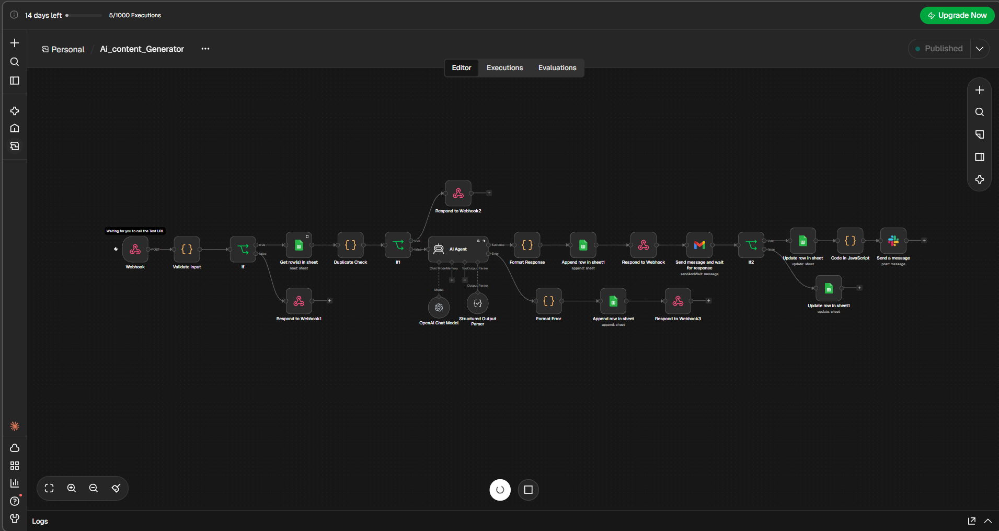

# AI Content Generator (n8n)

An n8n workflow that takes a **topic** and **content type** through a webhook, writes the content with an **AI Agent (OpenAI)**, stores it in **Google Sheets**, sends it for **email approval**, and posts approved content to **Slack**.

## Features

| Feature | How it works |
|---|---|
| Webhook input | `POST` with `topic`, `content_type` and optional `tone`, `length`, `language`, `reviewer_email`, `force` |
| Input validation | Missing or invalid fields return `400` with a list of errors |
| Duplicate tracker | A normalised `topic_key` (topic + type + language) is checked against the sheet. A duplicate returns the stored content instead of calling the AI (`from_cache: true`) |
| Multiple content types | `blog_post`, `social_media_caption`, `email_draft`, `product_description` |
| Multi-language | Any language via the `language` field |
| AI Agent | Tools Agent + OpenAI Chat Model + Structured Output Parser (`{title, content}`) |
| Error handling | Retries 3x, then a friendly message (invalid key, rate limit, server error), logged to an errors tab, returns `502` |
| Storage | Every result saved with metadata and a status |
| Approval | Gmail "Send and Wait" with Approve / Reject buttons |
| Publishing | Approved content is formatted for Slack and posted. The sheet status becomes `Approved` or `Rejected` |

## Flow

```
Webhook -> Validate Input -> Valid?
  |- no  -> 400
  '- yes -> Read History -> Duplicate Check -> Is Duplicate?
        |- yes -> Return stored content (from_cache: true)
        '- no  -> AI Agent
              |- error   -> Format Error -> Log Error -> 502
              '- success -> Format Response -> Save to Sheet -> Respond 200
                    -> Gmail approval -> Approved?
                         |- yes -> Mark Approved -> Format for Slack -> Slack
                         '- no  -> Mark Rejected
```

### Workflow Canvas


## Setup

### 1. Google Sheet
Create one spreadsheet with two tabs.

- **Sheet1** (content), with these headers in row 1:
  `Id | Topic | Topic_key | content_type | Tone | Language | Word_count | Generated_text | Status | Timestamp`
- **Sheet2** (errors), with these headers:
  `Topic | Content_type | Http_code | Error_message | Timestamp`

### 2. Import the workflow
n8n -> Workflows -> **Import from file** -> `workflow/ai-content-generator.json`

### 3. Add your own credentials
The export contains **no secrets**. After import, open each node and select your own:

| Node(s) | Credential / value to set |
|---|---|
| OpenAI Chat Model | OpenAI API key |
| All Google Sheets nodes | Google Sheets OAuth2 + choose your spreadsheet |
| Gmail approval node | Gmail OAuth2, and set the **To** address |
| Slack node | Slack OAuth2 + choose a channel |

Placeholders left in the file: `YOUR_GOOGLE_SHEET_ID`, `YOUR_SLACK_CHANNEL_ID`, `reviewer@example.com`.

### 4. Turn on "Always Output Data"
On the **Get row(s)** node (Settings tab), so the first run with an empty sheet doesn't stop.

### 5. Publish and call it
Test URL: `/webhook-test/generate-content` (click **Execute Workflow** first)
Production URL: `/webhook/generate-content` (workflow must be published)

## API

`POST /webhook/generate-content`

```json
{
  "topic": "Benefits of remote work",
  "content_type": "blog_post",
  "tone": "friendly",
  "length": "medium",
  "language": "English",
  "reviewer_email": "you@example.com",
  "force": false
}
```

| Field | Required | Default | Values |
|---|---|---|---|
| `topic` | yes | | text |
| `content_type` | yes | | `blog_post`, `social_media_caption`, `email_draft`, `product_description` |
| `tone` | no | `professional` | any |
| `length` | no | `medium` | `short`, `medium`, `long` |
| `language` | no | `English` | any |
| `reviewer_email` | no | placeholder in code | email |
| `force` | no | `false` | `true` regenerates a duplicate |

### Responses

| Code | Meaning |
|---|---|
| 200 | `from_cache: false` = new content, `from_cache: true` = stored content |
| 400 | Validation failed (`errors` list returned) |
| 502 | AI service error (message explains the cause) |

More sample bodies are in `postman-examples.json`.

## Testing checklist

1. Normal request: new row, approval email
2. Same request again: `from_cache: true`, AI node does not run
3. `"force": true`: new content
4. Each content type and a different language
5. Missing topic or bad type: `400`
6. Wrong OpenAI key: `502` and a row in the errors tab
7. Approve or Reject in the email: status updates, Slack post on Approve

## Security notes

- Never commit exported workflows straight from n8n. Raw exports contain credential IDs, sheet IDs, emails and instance IDs.
- Credentials stay inside n8n. They are not part of the workflow JSON.
- If you ever pushed a raw export, rotate the affected credentials.

## Tech

n8n (Cloud or self-hosted), OpenAI `gpt-4o-mini`, Google Sheets, Gmail, Slack.
