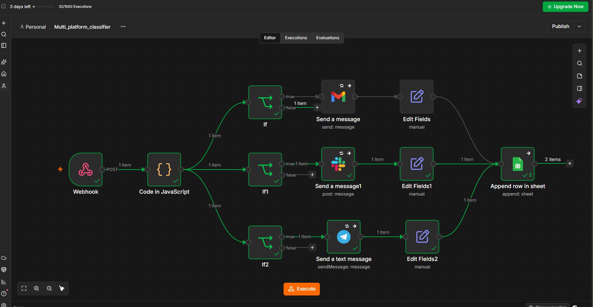

# Multi-Platform Notifier (n8n)

An [n8n](https://n8n.io) workflow that takes **one webhook request** and broadcasts a notification to multiple platforms in parallel. Which platforms receive it depends on the **priority level**, and every delivery is logged to Google Sheets.

## Features

- **Single input, multiple outputs:** one `POST` request fans out to Gmail, Slack and Telegram.
- **Parallel execution:** every platform branch starts at the same time.
- **Priority-based routing:** High, Medium and Low priorities go to different platforms.
- **Platform-specific formatting:** HTML for email, `*bold*` for Slack, HTML parse mode for Telegram.
- **Graceful failure handling:** if one platform fails, the others still deliver.
- **Retry mechanism:** each platform node retries up to 3 times with a 2-second wait.
- **Delivery log:** every attempt is appended to Google Sheets with platform, status, details, subject, priority and timestamp.
- **Safe defaults:** priority is case-insensitive and trimmed; missing or invalid priority falls back to Low.

## Architecture

```
                         ┌─> If (email?)    ─> Gmail    ─> Edit Fields  ──┐
Webhook ─> Code (route) ─┼─> If1 (slack?)   ─> Slack    ─> Edit Fields1 ──┼─> Google Sheets
                         └─> If2 (telegram?)─> Telegram ─> Edit Fields2 ──┘   (Append Row)


```
### Workflow Canvas



## Routing rules

| Priority | Email | Slack | Telegram |
|----------|:-----:|:-----:|:--------:|
| High     | ✅ | ✅ | ✅ |
| Medium   | ❌ | ✅ | ✅ |
| Low      | ❌ | ✅ | ❌ |

Edit the `routes` object in the **Code in JavaScript** node to change this.

## Requirements

- An n8n instance (cloud or self-hosted)
- A Gmail account (OAuth2)
- A Slack workspace and a Slack app with the `chat:write` scope
- A Telegram bot (created with [@BotFather](https://t.me/BotFather))
- A Google account with Google Sheets

## Setup

### 1. Import the workflow

In n8n: **Workflows → Import from File** → select `Multi_platform_notifier.json`.

> The exported file contains **no secrets**. Placeholders like `YOUR_EMAIL@example.com` must be replaced with your own values.

### 2. Create credentials

| Node | Credential | Notes |
|------|-----------|-------|
| Send a message (Gmail) | Gmail OAuth2 | Sign in with Google |
| Send a message1 (Slack) | Slack OAuth2 | Add `chat:write`, install the app, then `/invite @YourBot` in the channel |
| Send a text message (Telegram) | Telegram API | Paste the token from BotFather |
| Append row in sheet | Google Sheets OAuth2 | Enable the Google Sheets API (self-hosted only) |

### 3. Replace placeholders

| Placeholder | Where | What to put |
|-------------|-------|-------------|
| `YOUR_EMAIL@example.com` | Gmail node → To | Recipient address |
| `YOUR_SLACK_CHANNEL_ID` | Slack node → Channel | Pick your channel from the list |
| `YOUR_TELEGRAM_CHAT_ID` | Telegram node → Chat ID | Your numeric chat ID |
| `YOUR_GOOGLE_SHEET_ID` | Google Sheets node → Document | Select your sheet from the list |

**Getting your Telegram chat ID:** open your bot and press **Start**, send it any message, then visit
`https://api.telegram.org/bot<YOUR_TOKEN>/getUpdates` and find `"chat":{"id":...}`.

### 4. Prepare the Google Sheet

Create a sheet with these headers in row 1:

| Platform | Status | Detail | Subject | Priority | timestamp |
|----------|--------|--------|---------|----------|-----------|

Match the column mapping in the Google Sheets node to your headers.

### 5. Activate

Save, then toggle the workflow **Active**. Use the **Production URL** shown in the Webhook node.

## Usage

**Endpoint:** `POST <your-n8n-url>/webhook/notify`

**Body:**
```json
{
  "subject": "Server Down",
  "message": "The production server is not responding.",
  "priority": "High"
}
```

| Field | Required | Description |
|-------|----------|-------------|
| `subject` | Yes | Title of the notification |
| `message` | Yes | Body text |
| `priority` | No | `High`, `Medium` or `Low` (default: `Low`) |

**cURL:**
```bash
curl -X POST "https://YOUR-N8N-URL/webhook/notify" \
  -H "Content-Type: application/json" \
  -d '{"subject":"Server Down","message":"Production is not responding.","priority":"High"}'
```

While testing, use the **Test URL** (`/webhook-test/notify`) and click **Execute workflow** first.

## Test cases

| Input priority | Expected platforms | Sheet rows |
|----------------|--------------------|-----------:|
| `High` | Email, Slack, Telegram | 3 |
| `Medium` | Slack, Telegram | 2 |
| `Low` | Slack | 1 |
| `high` / `  HIGH  ` | Same as High | 3 |
| missing / empty / `null` / `1` / `Urgent` | Falls back to Low | 1 |

**Failure test:** break one credential (for example, change a character of the Telegram token), send a High message, and confirm the other platforms still deliver and the sheet logs `Failed` for the broken one.

## Troubleshooting

| Problem | Fix |
|---------|-----|
| Slack `not_in_channel` | Invite the bot to the channel |
| Telegram `chat not found` | Press **Start** on your bot first |
| Gmail `Invalid email address` | Check the **To** field contains a plain valid address |
| Telegram shows raw `<b>` tags | Set **Parse Mode** to HTML |
| Webhook returns 404 | Test URL: click **Execute workflow** first. Production URL: activate the workflow |
| All platforms receive every priority | Check each platform hangs off the **true** output of its own IF node |
| Sheet rows show wrong platform | Make sure each Edit Fields node has a fixed `Platform` value |

## Roadmap

- [ ] Discord notifications
- [ ] Microsoft Teams or SMS (Twilio)
- [ ] Input validation with a clear error response

## Security

- Credentials are stored in n8n, **never** in the exported JSON.
- Do not commit screenshots or exports that show real tokens, chat IDs, email addresses or sheet URLs.
- Consider adding header authentication to the Webhook node before exposing it publicly, otherwise anyone with the URL can send notifications.

## License

MIT
