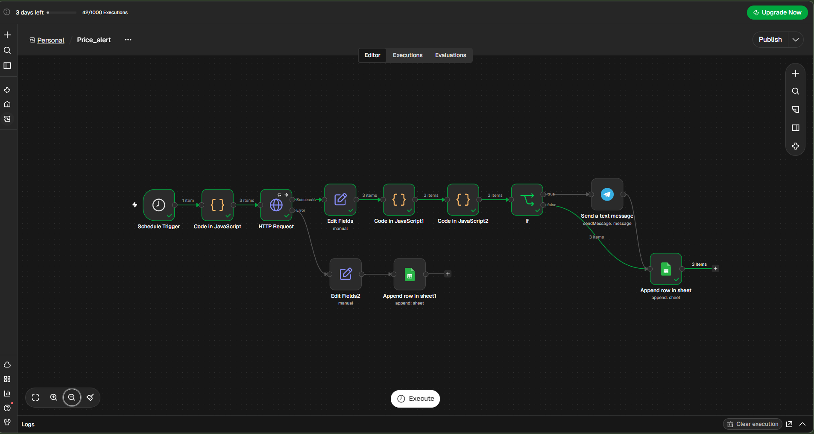

# Price Drop Alert Tracker (n8n)

An n8n workflow that checks product prices on a schedule, sends a Telegram alert when a price drops below a user-defined threshold, and logs every check to Google Sheets.

## Features

- **Scheduled checks**: runs every 6 hours (configurable)
- **Multiple products**: each product has its own threshold
- **Threshold alerts**: Telegram message with product name, current price, previous price, trend, threshold, availability and product link
- **Price history and trend**: detects `Rising`, `Falling`, `Stable` or `First check` per product
- **Alert cooldown**: no repeat alerts for the same product within 24 hours
- **Google Sheets logging**: every check is logged with timestamp, price, threshold, status and trend
- **Error handling**: failed API calls (404, API down) are retried, then logged to a separate sheet instead of crashing the workflow

## Workflow overview

```
Schedule Trigger
   -> Code (product list + thresholds)
   -> HTTP Request ──(success)──> Edit Fields (parse product)
        |                              -> Trend (price history)
        |                              -> Cooldown (24h per product)
        |                              -> IF (sendAlert is true?)
        |                                   ├─ true  -> Telegram -> Google Sheets (log)
        |                                   └─ false ------------> Google Sheets (log)
        └──(error)───> Edit Fields2 -> Google Sheets (error log, Sheet2)
```

### Workflow Canvas


| Node | Purpose |
|---|---|
| Schedule Trigger | Starts the workflow every 6 hours |
| Code in JavaScript | Defines products: `productId`, `threshold`, `productUrl` |
| HTTP Request | Fetches product data (retry on fail, 10 s timeout, error output enabled) |
| Edit Fields | Extracts name, price, availability, link, timestamp |
| Code in JavaScript1 | Compares with last price (workflow static data) and sets `trend` |
| Code in JavaScript2 | Applies threshold and 24h cooldown, sets `sendAlert` and `status` |
| If | Routes to Telegram only when `sendAlert` is true |
| Telegram | Sends the alert |
| Append row in sheet | Logs each check to `Sheet1` |
| Edit Fields2 + Append row in sheet1 | Logs API errors to `Sheet2` |

## API used

[DummyJSON](https://dummyjson.com/products/1): a free mock API, no key required. The workflow reads `title`, `price` and `availabilityStatus`. Requesting a non-existent id (e.g. `/products/99999`) returns a 404, which is useful for testing the error path.

## Setup

### 1. Import the workflow
In n8n: **Workflows -> Import from File** and select `price-drop-alert-workflow.json`.

### 2. Create the Google Sheet
Create a spreadsheet with two tabs.

**Sheet1** (price log), header row:

```
Product | Price | Threshold | Availability | PreviousPrice | Trend | Status | Timestamp
```

**Sheet2** (error log), header row:

```
Product | Price | Threshold | Availability | Status | Timestamp
```

### 3. Add credentials in n8n
Credentials are **not** included in this repo. Create them in n8n and select them on the nodes:

- **Telegram**: create a bot with [@BotFather](https://t.me/BotFather), copy the token into a Telegram API credential. Send any message to your bot, then open `https://api.telegram.org/bot<TOKEN>/getUpdates` to find your chat id.
- **Google Sheets**: create a Google Sheets OAuth2 credential and authorize your account.

### 4. Replace the placeholders
After import, update these on the nodes:

| Node | Field | Replace |
|---|---|---|
| Send a text message | Chat ID | `YOUR_TELEGRAM_CHAT_ID` -> your chat id |
| Append row in sheet | Document | `YOUR_GOOGLE_SHEET_ID` -> your spreadsheet id, sheet `Sheet1` |
| Append row in sheet1 | Document | `YOUR_GOOGLE_SHEET_ID` -> your spreadsheet id, sheet `Sheet2` |

The spreadsheet id is the long string in the sheet URL: `https://docs.google.com/spreadsheets/d/<SPREADSHEET_ID>/edit`.

### 5. Configure products
Edit the **Code in JavaScript** node:

```javascript
return [
  { json: { productId: 1, threshold: 15, productUrl: "https://dummyjson.com/products/1" } },
  { json: { productId: 2, threshold: 10, productUrl: "https://dummyjson.com/products/2" } },
  { json: { productId: 3, threshold: 8,  productUrl: "https://dummyjson.com/products/3" } }
];
```

### 6. Publish
Click **Publish** so the schedule runs automatically.

## Configuration

| Setting | Where | Default |
|---|---|---|
| Check interval | Schedule Trigger | 6 hours |
| Product list and thresholds | Code in JavaScript | 3 products |
| Alert cooldown | `COOLDOWN_HOURS` in Code in JavaScript2 | 24 |
| Request timeout | HTTP Request -> Options | 10 s |

## Testing

| Test | How | Expected result |
|---|---|---|
| Alert path | Threshold above current price (e.g. 15 for a 9.99 product) | Telegram alert, `Alert sent` in sheet |
| No-alert path | Threshold below current price | No message, `Above threshold` in sheet |
| Cooldown | Run again after an alert | `Cooldown (skipped)`, no new message |
| Error path | Use `productId` 99999 | Error row in `Sheet2` |
| Trend | Run at least twice on the **published** workflow | `Stable` / `Rising` / `Falling` |

## Notes and limitations

- **Static data only persists on published (active) runs.** Manual "Execute workflow" runs will always show `First check` and ignore cooldown history.
- DummyJSON prices never change, so the trend is always `Stable` unless you simulate a price change for testing.
- To reset cooldown and price history for testing, unpublish and publish the workflow again, or temporarily set `COOLDOWN_HOURS = 0`.
- Cooldown and trend state are stored per `productId` in workflow static data.

## Tech

n8n, DummyJSON API, Telegram Bot API, Google Sheets API
