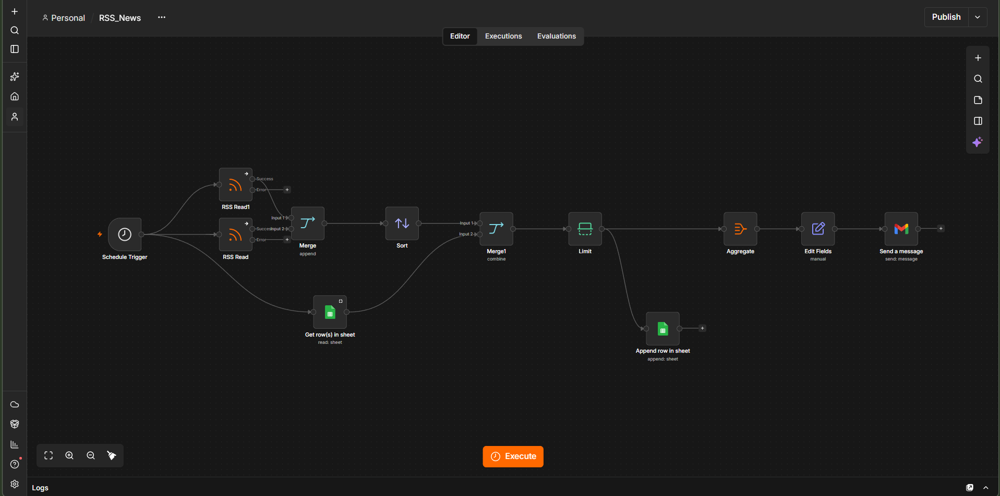

# Daily Top 3 News – n8n Automation

An n8n workflow that sends me an email every morning with the 3 latest news
headlines from BBC News and The Verge. It skips stories I've already received
and keeps a log in Google Sheets.

## What it does

1. **Schedule Trigger** – runs every day at 8:00 AM.
2. **RSS Read** – fetches the latest articles from:
   - BBC News: https://feeds.bbci.co.uk/news/rss.xml
   - The Verge: https://www.theverge.com/rss/index.xml
3. **Merge** – combines both feeds into one list.
4. **Sort** – sorts articles by publish date (newest first).
5. **Get row(s) in sheet** – reads the links already saved in Google Sheets.
6. **Merge1** – compares by link and keeps only new articles (no duplicates).
7. **Limit** – keeps the top 3.
8. **Append row in sheet** – saves Title, link and Sent_Date to Google Sheets.
9. **Aggregate + Edit Fields** – builds a formatted HTML email.
10. **Send a message (Gmail)** – emails the Top 3 headlines.

## Tools used

- n8n
- RSS feeds (BBC News, The Verge)
- Google Sheets
- Gmail

## How to use this workflow

1. Download `Assignment 1_RSS_News.json` from this repo.
2. In n8n, create a new workflow, then click **... > Import > From file**.
3. Create a Google Sheet with these column headers: `Title`, `link`, `Sent_Date`.
4. In both Google Sheets nodes, connect your Google account and select your sheet
   (replaces `YOUR_SHEET_ID`).
5. In the Gmail node, connect your Gmail account and replace
   `YOUR_EMAIL_ADDRESS` with your email.
6. Click **Execute** to test, then **Publish** to run it daily.

## Screenshots

### Workflow Canvas

## Note

Personal details (Sheet ID and email address) have been replaced with
placeholders. No passwords or API keys are included in the file.

## Author

Abha Maurya
