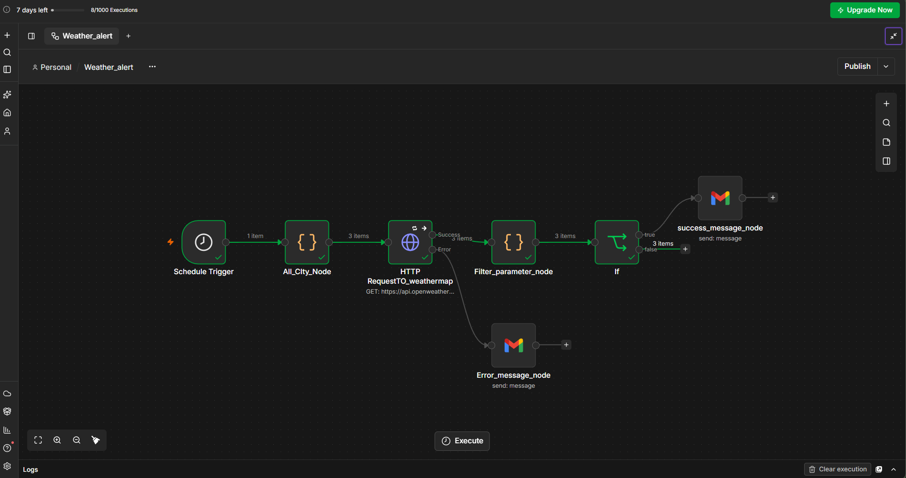

# Weather Alert Notification Workflow (n8n)

An n8n workflow that checks the weather forecast for the next 24 hours every morning at 7:00 AM and sends an email alert **only if rain is expected**. If there is no rain, the workflow ends quietly, so there are no spam alerts.

## Features
- Runs automatically every day at 7:00 AM
- Checks the forecast for the **next 24 hours** (not just the current weather)
- Supports **multiple cities**: Varanasi, Lucknow and Delhi, with a separate alert for each city
- Detects rain, drizzle and thunderstorm
- Alert includes condition, temperature, humidity, wind speed, chance of rain and expected rain time
- **Error handling:** sends an email if the weather API fails (invalid API key, wrong URL, network problem)

## Workflow



```
Schedule Trigger → All_CIty_Node → HTTP RequestTO_weathermap → Filter_parameter_node → If → success_message_node
                                            │                                          (false → stop, no email)
                                            └── (error) → Error_message_node
```

## How each node works

### 1. Schedule Trigger
Starts the workflow every day at **7:00 AM**.

### 2. All_CIty_Node (Code)
Creates one item for each city:
```js
return [
  { json: { city: 'Varanasi,IN' } },
  { json: { city: 'Lucknow,IN' } },
  { json: { city: 'Delhi,IN' } }
];
```
Because each city is a separate item, every node after this runs once per city, so each city gets its own check and its own alert.

### 3. HTTP RequestTO_weathermap (HTTP Request)
Calls the OpenWeatherMap **5-day / 3-hour forecast API**:
- **URL:** `https://api.openweathermap.org/data/2.5/forecast`
- **Method:** GET
- **Query parameters:**
  | Name | Value | Purpose |
  |---|---|---|
  | `q` | `{{ $json.city }}` | City name from the previous node |
  | `appid` | `YOUR_API_KEY` | OpenWeatherMap API key |
  | `units` | `metric` | Temperature in °C |
  | `cnt` | `8` | 8 time slots × 3 hours = next 24 hours |

**Error handling:** the node's error output is turned on. If the request fails, the item goes to `Error_message_node` instead of stopping the workflow.

### 4. Filter_parameter_node (Code)
The API returns a long list of 8 forecast slots. This node:
1. Looks through all 8 slots for **Rain**, **Drizzle** or **Thunderstorm**
2. Picks the first rainy slot, or the first slot if there is no rain
3. Returns a clean set of fields:

| Field | Meaning |
|---|---|
| `city` | City name |
| `checkedAt` | Date and time of the check |
| `rainExpected` | `true` if rain is expected in the next 24 hours |
| `condition` | Weather description (e.g. "light rain") |
| `temperature` | Temperature in °C |
| `humidity` | Humidity in % |
| `windSpeed` | Wind speed in m/s |
| `rainTime` | Time when rain is expected |
| `rainChance` | Highest chance of rain in the next 24 hours (%) |

A Code node is used instead of Edit Fields because the logic loops through 8 slots and picks values from one chosen slot. That is cleaner in one Code node than repeating the same logic in every field.

### 5. If
Checks `{{ $json.rainExpected }}` **is true**.
- **True:** goes to `success_message_node` and sends the alert
- **False:** nothing is connected, so the workflow ends without sending an email

### 6. success_message_node (Gmail)
Sends the rain alert email with the weather details:
```
Rain expected in {{ $json.city }} around {{ $json.rainTime }}
Condition: {{ $json.condition }}
Temperature: {{ $json.temperature }} °C
Humidity: {{ $json.humidity }}%
Wind: {{ $json.windSpeed }} m/s
Chance of rain: {{ $json.rainChance }}%
```

### 7. Error_message_node (Gmail)
Connected to the **error output** of the HTTP Request node. If the API call fails, it sends an email with the subject **"weather check failed"** and the error message, so failures are never silent.


## canvas results


## How to use
1. Sign up at [openweathermap.org](https://openweathermap.org/api) and get a free API key.
2. In n8n, click **Import from File** and choose `Weather_alert.json`.
3. Open **HTTP RequestTO_weathermap** and replace `YOUR_API_KEY` with your key.
4. Open both Gmail nodes, connect your Gmail account and set your email address.
5. Change the cities in **All_CIty_Node** if you want.
6. Click **Execute Workflow** to test, then **Publish** it so it runs every morning.

## Testing
- **No rain:** the If node sends items to the false branch, and no email is sent.
- **Rain:** tested by temporarily changing the If condition to "is false", which confirmed the alert email is sent with correct details.
- **Error:** tested with a wrong URL. The API returned 404, and the error email was sent for each city.


